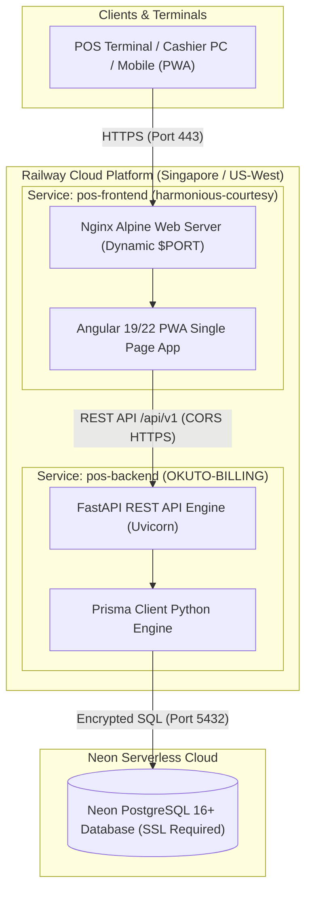

# 🚀 Greenfield Mart POS & Billing System — Complete Railway & Neon DB Production Deployment Guide

A comprehensive, production-grade deployment guide for deploying the **FastAPI Backend**, **Angular 19/22 PWA Frontend**, and **Neon Serverless PostgreSQL Database** on **Railway**.

---

## 📑 Table of Contents
1. [Architecture & Services Topology](#1-architecture--services-topology)
2. [Project Files & Deployment Assets](#2-project-files--deployment-assets)
3. [Neon DB (Serverless PostgreSQL) Setup](#3-neon-db-serverless-postgresql-setup)
4. [Backend Service (`pos-backend`) Deployment](#4-backend-service-pos-backend-deployment)
5. [Frontend Service (`pos-frontend`) Deployment](#5-frontend-service-pos-frontend-deployment)
6. [CORS & Frontend-Backend Interconnection](#6-cors--frontend-backend-interconnection)
7. [Database Migration & Automated Seeding](#7-database-migration--automated-seeding)
8. [Security, Authentication & Role Matrix](#8-security-authentication--role-matrix)
9. [Deployment Verification & Health Check Checklist](#9-deployment-verification--health-check-checklist)
10. [Comprehensive Troubleshooting Guide](#10-comprehensive-troubleshooting-guide)

---

## 1. Architecture & Services Topology



---

## 2. Project Files & Deployment Assets

### Backend (`/backend`)
* [`backend/Dockerfile`](file:///c:/Yunus/Internship/Billing%20Software/phase%201%20app/backend/Dockerfile): Python 3.12-slim base image with Prisma CLI generation (`prisma generate && prisma py fetch`) and Uvicorn runtime.
* [`backend/requirements.txt`](file:///c:/Yunus/Internship/Billing%20Software/phase%201%20app/backend/requirements.txt): FastAPI, Uvicorn, Prisma Client, Pydantic v2, Python-Jose (JWT), Passlib (Bcrypt/PBKDF2), Pytest, Celery, Redis.
* [`backend/prisma/schema.prisma`](file:///c:/Yunus/Internship/Billing%20Software/phase%201%20app/backend/prisma/schema.prisma): PostgreSQL schema definition (User, Category, Product, Sale, SaleItem, SaleReturn, HeldBill, DiscountRule, AuditLog, CashCounter, StoreSettings).
* [`backend/app/main.py`](file:///c:/Yunus/Internship/Billing%20Software/phase%201%20app/backend/app/main.py): Application entrypoint with database lifespan connection, seed on first start, and CORS middleware.
* [`backend/app/config.py`](file:///c:/Yunus/Internship/Billing%20Software/phase%201%20app/backend/app/config.py): Configuration reader from environment variables.
* [`backend/seed_db.py`](file:///c:/Yunus/Internship/Billing%20Software/phase%201%20app/backend/seed_db.py): Initial data seeder for Admin/Cashier accounts, grocery categories, sample products, discount rules, and store settings.

### Frontend (`/frontend`)
* [`frontend/Dockerfile`](file:///c:/Yunus/Internship/Billing%20Software/phase%201%20app/frontend/Dockerfile): Multi-stage container (Stage 1: Node 22 build; Stage 2: Nginx Alpine).
* [`frontend/nginx.conf`](file:///c:/Yunus/Internship/Billing%20Software/phase%201%20app/frontend/nginx.conf): Nginx configuration template dynamically reading Railway's `${PORT}`, SPA HTML5 fallback routing, and static asset caching.
* [`frontend/angular.json`](file:///c:/Yunus/Internship/Billing%20Software/phase%201%20app/frontend/angular.json): Production build pipeline and PWA service worker descriptors.
* [`frontend/package.json`](file:///c:/Yunus/Internship/Billing%20Software/phase%201%20app/frontend/package.json): Angular 19/22, Angular CDK, TypeScript 5.5, RxJS.

---

## 3. Neon DB (Serverless PostgreSQL) Setup

### Step 3.1: Create Project in Neon
1. Log in to [Neon Console](https://console.neon.tech/).
2. Create a new project named `okuto-billing-db`.
3. Select **PostgreSQL 16**.
4. Choose the cloud region closest to your Railway deployment (e.g. **AWS Asia Pacific (Singapore)** or **US West**).

### Step 3.2: Copy Database Connection String
From your Neon project dashboard under **Connection Details**:
```text
postgresql://<NEON_USER>:<NEON_PASSWORD>@<NEON_HOST>.neon.tech/<NEON_DB>?sslmode=require
```

> [!IMPORTANT]
> Always ensure `?sslmode=require` is present at the end of the connection string to allow secure encrypted database transactions.

---

## 4. Backend Service (`pos-backend`) Deployment

### 4.1 Service Settings Configuration (Railway)
* **Service Name:** `okuto-billing-backend` (or `OKUTO-BILLING`)
* **Source Repository:** `OKUTOBUS-TECH/OKUTO-BILLING`
* **Root Directory:** `/backend`
* **Branch:** `develop` (or `main`)
* **Builder:** `Dockerfile` (automatically detects `/backend/Dockerfile`)
* **Watch Paths:** `/backend/**`
* **Healthcheck Path:** `/`
* **Serverless:** `OFF`
* **Restart Policy:** `On Failure` (10 retries)

### 4.2 Environment Variables (Variables Tab)

| Variable Key | Production Value | Required | Purpose |
| :--- | :--- | :--- | :--- |
| `DATABASE_URL` | `postgresql://<user>:<password>@<host>.neon.tech/<db>?sslmode=require` | **YES** | Neon PostgreSQL connection string |
| `SECRET_KEY` | `<GENERATE_A_64_CHAR_RANDOM_HEX>` | **YES** | Cryptographic secret for signing JWT tokens |
| `ALGORITHM` | `HS256` | **YES** | Token encryption algorithm |
| `ACCESS_TOKEN_EXPIRE_MINUTES` | `720` | Optional | Session expiry (12 hours) |
| `API_V1_STR` | `/api/v1` | Optional | Router prefix |
| `PROJECT_NAME` | `Greenfield Mart POS & Billing System` | Optional | Swagger documentation title |
| `AZURE_STORAGE_CONNECTION_STRING` | `""` (or Azure connection string) | Optional | Cloud backup storage |

### 4.3 Public Networking & Domain
1. In the **Settings** tab under **Networking**, click **Generate Domain**.
2. Example domain: `https://okuto-billing-production.up.railway.app`
3. Click the **Edit (pencil)** icon on the domain and ensure the mapped port is **`8000`** (or matches the container `$PORT`).

---

## 5. Frontend Service (`pos-frontend`) Deployment

### 5.1 Service Settings Configuration (Railway)
* **Service Name:** `okuto-billing-frontend` (renamed from `harmonious-courtesy`)
* **Source Repository:** `OKUTOBUS-TECH/OKUTO-BILLING`
* **Root Directory:** `/frontend`
* **Branch:** `develop` (or `main`)
* **Builder:** `Dockerfile` (automatically detects `/frontend/Dockerfile`)
* **Watch Paths:** `/frontend/**`
* **Healthcheck Path:** `/`
* **Edge CDN Caching:** `ON` (Accelerates static asset delivery)
* **Serverless:** `OFF`
* **Restart Policy:** `On Failure` (10 retries)

### 5.2 Environment Variables (Variables Tab)

| Variable Key | Value | Purpose |
| :--- | :--- | :--- |
| `PORT` | `80` (or dynamic Railway default) | Port passed into Nginx template |

### 5.3 Public Networking & Domain
1. In the **Settings** tab under **Networking**, click **Generate Domain**.
2. Example domain: `https://harmonious-courtesy-production-5b4d.up.railway.app`
3. Verify the domain target port matches the Nginx port.

---

## 6. CORS & Frontend-Backend Interconnection

### 6.1 Backend CORS Configuration
In [`backend/app/main.py`](file:///c:/Yunus/Internship/Billing%20Software/phase%201%20app/backend/app/main.py#L62-L69), CORS is enabled for frontend origins:

```python
app.add_middleware(
    CORSMiddleware,
    allow_origins=[
        "https://harmonious-courtesy-production-5b4d.up.railway.app",
        "http://localhost:4200",
        "*"
    ],
    allow_credentials=True,
    allow_methods=["*"],
    allow_headers=["*"],
)
```

### 6.2 Endpoint URLs Reference
All REST API operations are namespaced under `/api/v1`:

| API Resource | URL Endpoint | Method |
| :--- | :--- | :--- |
| **Authentication** | `https://<backend-domain>/api/v1/auth/token` | `POST` |
| **Catalog Items** | `https://<backend-domain>/api/v1/catalog/items` | `GET` / `POST` |
| **Categories** | `https://<backend-domain>/api/v1/catalog/categories` | `GET` |
| **Sample CSV** | `https://<backend-domain>/api/v1/catalog/sample-csv` | `GET` |
| **Create Sale** | `https://<backend-domain>/api/v1/billing/sale` | `POST` |
| **Held Bills** | `https://<backend-domain>/api/v1/billing/held-bills` | `GET` / `POST` |
| **Discounts** | `https://<backend-domain>/api/v1/discounts` | `GET` / `POST` |
| **Z-Report** | `https://<backend-domain>/api/v1/reports/z-report` | `GET` |
| **Staff Users** | `https://<backend-domain>/api/v1/users` | `GET` / `POST` |
| **Store Settings** | `https://<backend-domain>/api/v1/settings/store` | `GET` / `PUT` |

---

## 7. Database Migration & Automated Seeding

### Automatic Seeding on Railway Boot
When the backend container starts on Railway, the `lifespan` function in [`backend/app/main.py`](file:///c:/Yunus/Internship/Billing%20Software/phase%201%20app/backend/app/main.py#L46-L53) executes:
```python
@asynccontextmanager
async def lifespan(app: FastAPI):
    await connect_db()
    try:
        await seed_data()
    except Exception as e:
        print(f"Data seed notice: {e}")
    yield
    await disconnect_db()
```
If the Neon DB tables are empty, it automatically populates default admin/cashier staff, supermarket categories, products, tax slabs, and store profile.

### Manual Schema Push (Local or Railway CLI)
To push schema changes manually:
```bash
# Push schema tables to Neon
python -m prisma db push --schema=./prisma/schema.prisma

# Manually trigger seed script
python seed_db.py
```

---

## 8. Security, Authentication & Role Matrix

### 8.1 Default Production Accounts

| Role | Username | Full Name | Default PIN | Permissions |
| :--- | :--- | :--- | :--- | :--- |
| **Administrator** | `owner.arjun` | Arjun M. | `9999` | Full access to POS, Inventory, Bulk CSV, Discounts, Users, Store Settings, Z-Reports & Refunds. |
| **Cashier 1** | `priya.k` | Priya K. | `1234` | Billing, Cart Checkout, Hold & Recall, Barcode Scanning. Restricted from admin management. |
| **Cashier 2** | `ravi.s` | Ravi S. | `2345` | Billing, Cart Checkout, Hold & Recall, Barcode Scanning. |

### 8.2 Security Hardening
* **PIN & Password Storage:** Stored using PBKDF2-SHA256 and Bcrypt cryptographic hashing ([`backend/app/security.py`](file:///c:/Yunus/Internship/Billing%20Software/phase%201%20app/backend/app/security.py)).
* **JWT Tokens:** Issued upon successful PIN verification and signed using `HS256` with expiration.
* **Auto-Lock Screen:** Terminal automatically prompts for PIN re-entry after idle timeout.

---

## 9. Deployment Verification & Health Check Checklist

Execute the following verification tests once both Railway services show **Active**:

- [ ] **1. Health Check Endpoint**  
  `curl -i https://<backend-domain>/`  
  *Expected:* HTTP 200 `{"status": "online", "app": "...", "version": "2.0.0", "docs": "/docs"}`

- [ ] **2. Swagger Documentation**  
  Open `https://<backend-domain>/docs` in your browser.  
  *Expected:* Interactive Swagger UI displaying all 7 API routers.

- [ ] **3. Staff Login Test**  
  `curl -X POST https://<backend-domain>/api/v1/auth/token -H "Content-Type: application/json" -d "{\"pin\": \"9999\"}"`  
  *Expected:* HTTP 200 with JWT `access_token` and user profile object.

- [ ] **4. Catalog Query**  
  `curl https://<backend-domain>/api/v1/catalog/items`  
  *Expected:* JSON array containing items (Cola, Orange Juice, Basmati Rice, etc.).

- [ ] **5. Frontend POS Access**  
  Open `https://<frontend-domain>/` in browser.  
  *Expected:* Greenfield Mart POS interface loads cleanly, sidebar navigates, and PIN pad functions.

- [ ] **6. PWA Manifest**  
  `curl https://<frontend-domain>/manifest.webmanifest`  
  *Expected:* Valid PWA descriptor JSON.

---

## 10. Comprehensive Troubleshooting Guide

### Issue 1: Prisma Query Engine Binary Missing in Container
* **Error:** `Prisma Client Python requires query-engine binary...`
* **Fix:** The [`backend/Dockerfile`](file:///c:/Yunus/Internship/Billing%20Software/phase%201%20app/backend/Dockerfile#L20-L21) runs:
  ```dockerfile
  RUN python -m prisma generate --schema=./prisma/schema.prisma
  RUN python -m prisma py fetch
  ```
  Ensure these two lines are present before copying application files.

### Issue 2: Nginx Port 80 Permission Denied on Railway
* **Error:** `nginx: [emerg] bind() to 0.0.0.0:80 failed (13: Permission denied)`
* **Fix:** Railway uses dynamic non-privileged ports. The [`frontend/nginx.conf`](file:///c:/Yunus/Internship/Billing%20Software/phase%201%20app/frontend/nginx.conf#L1-L3) is configured as a template with `listen ${PORT};` and processed automatically by Nginx on startup.

### Issue 3: Neon Connection Timeout / SSL Error
* **Error:** `asyncpg / prisma.errors.DataError: connection requires SSL`
* **Fix:** Add `?sslmode=require` to the end of the `DATABASE_URL` variable in the backend service variables.

### Issue 4: Angular SPA 404 on Page Refresh
* **Error:** Refreshing `/pos` or `/reports` returns 404 from Nginx.
* **Fix:** Handled in [`frontend/nginx.conf`](file:///c:/Yunus/Internship/Billing%20Software/phase%201%20app/frontend/nginx.conf#L8-L10) using:
  ```nginx
  location / {
      try_files $uri $uri/ /index.html;
  }
  ```
